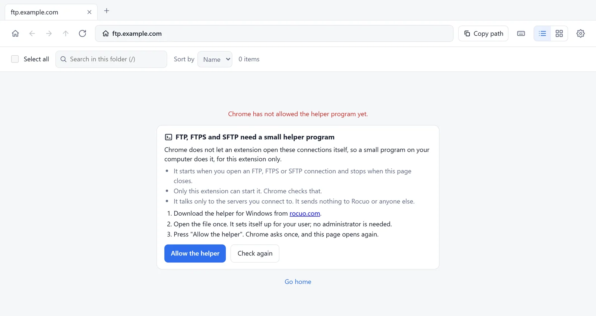
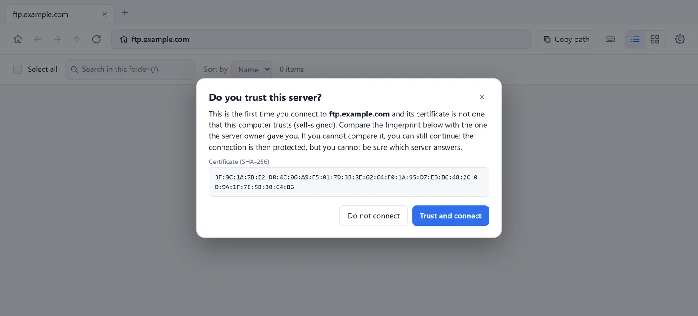
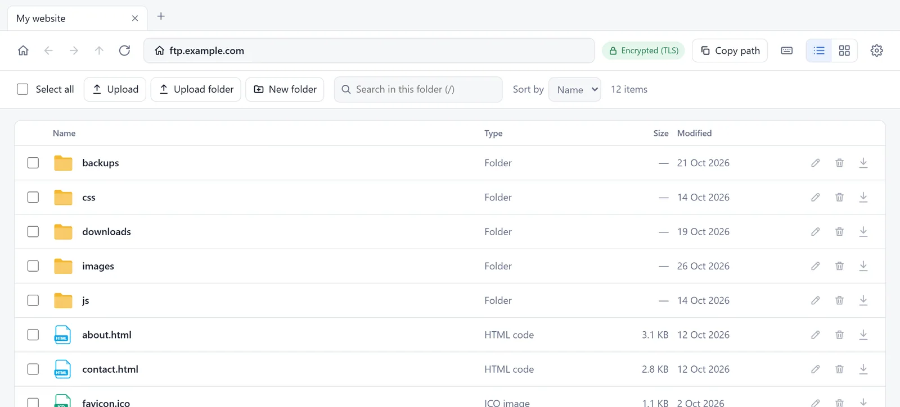
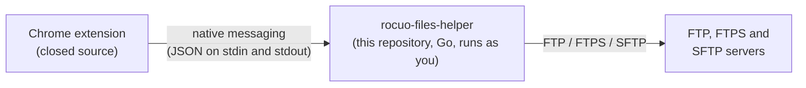

# Remote Files Browser FTP: the helper program

[](https://github.com/Maool2122/remote-files-browser/actions/workflows/ci.yml)
[](LICENSE)
[](https://chromewebstore.google.com/detail/remote-files-browser-ftp/pckgpblcplbjffapabndpkhnhkioihjd)

**The open source helper program of the Chrome extension [Remote Files Browser FTP by Rocuo](https://chromewebstore.google.com/detail/remote-files-browser-ftp/pckgpblcplbjffapabndpkhnhkioihjd).** It runs on your own computer and opens **FTP, FTPS and SFTP** connections for the extension, because Chrome does not let an extension open them itself. Since version 1.1.0 it can also read the servers that you saved in **FileZilla, WinSCP or Cyberduck**, when you press a button in the extension, so that you do not type them again (names, addresses, ports, user names and start folders; never a password).

**Only the helper is open source.** The extension is free to use, but its source is closed. The helper is the part that runs outside the browser, on your computer, with your own rights, so it is the part you should be able to check: you can read every line of it, build it yourself, compare a download with the source, test it on your own system, and build on it. Why: [docs/WHY-OPEN-SOURCE.md](docs/WHY-OPEN-SOURCE.md).

[**Get the extension (Chrome Web Store)**](https://chromewebstore.google.com/detail/remote-files-browser-ftp/pckgpblcplbjffapabndpkhnhkioihjd) ·
[Website](https://rocuo.com/remote-files/) ·
[Helper documents](helper/README.md) ·
[Documents](docs/README.md) ·
[Releases](https://github.com/Maool2122/remote-files-browser/releases) ·
[Report a problem](https://github.com/Maool2122/remote-files-browser/issues/new/choose)

<table>
  <tr>
    <td width="33%"><br><sub><b>Where a person meets the helper:</b> the extension says what it is and asks once.</sub></td>
    <td width="33%"><br><sub><b>Trust questions</b> like a good FTP or SSH program: the helper stops, the person sees the fingerprint and decides.</sub></td>
    <td width="33%"><br><sub><b>FTP over TLS</b> with upload, new folder, rename and delete.</sub></td>
  </tr>
</table>

(Screens of the extension, which uses the helper. They show made-up servers. The pictures are not under the MIT licence: [TRADEMARKS.md](TRADEMARKS.md).)

## What it is, and what it is not

| It is | It is not |
| --- | --- |
| A program that Chrome starts when the extension asks for an FTP, FTPS or SFTP connection, and that ends when the extension page closes or Chrome stops. | A service, a daemon or a startup item. It does not start with the computer and runs nothing in the background. |
| A client: it connects **out** to the server you typed in. | A server. It listens on no port and accepts no connection from anyone. |
| Run as you, without administrator rights. It writes only its own copy and its registration. | Something that needs an administrator, a driver or a change of the system. |
| Silent towards Rocuo: it makes no connection except to the servers you open, sends no statistics and checks for no updates by itself. | A tracker. There is no account, no analytics and no server of Rocuo behind it. |
| Able to read the servers saved in FileZilla, WinSCP and Cyberduck, **only when you press the import button** in the extension (since 1.1.0): names, addresses, ports, user names and start folders. | A reader of passwords. It never reads a password or a key file from those programs, and never writes to them. |

It is written in Go, builds to one file per system (about 7 MB on Windows) and needs no other software. Version `1.1.0`, message version (protocol) `1`.

## How it works



1. The extension page asks Chrome to start the program named `com.rocuo.remote_files_helper`.
2. Chrome looks the name up in a small registration file that the helper wrote when it was installed. **Chrome starts the program only for the extensions listed in that file.**
3. The two talk in JSON messages ([the protocol](helper/docs/PROTOCOL.md)). The helper opens the connection to the server, lists folders, reads and writes files, and answers. When you press **Import saved servers** in the extension, it instead reads the lists that FileZilla, WinSCP and Cyberduck keep for you on the same computer, and answers with names, addresses, ports, user names and start folders (never a password).
4. When the page closes, Chrome closes the pipe, and the helper ends its connections and exits.

How the program is built, file by file: [helper/docs/ARCHITECTURE.md](helper/docs/ARCHITECTURE.md).

## Install

You rarely need this page: the extension shows these steps itself, with the right file for your system, when you open an FTP, FTPS or SFTP address.

1. **The extension:** [Chrome Web Store](https://chromewebstore.google.com/detail/remote-files-browser-ftp/pckgpblcplbjffapabndpkhnhkioihjd) (Chrome 110 or newer).
2. **The helper:** get the file for your system from the [Releases](https://github.com/Maool2122/remote-files-browser/releases) of this repository (built by GitHub from the tagged source, with a build attestation) or from <https://rocuo.com/remote-files/ftp-helper/>. **Check it** against `SHA256SUMS.txt` ([how](docs/VERIFYING-DOWNLOADS.md)). Open it once (double-click on Windows). It copies itself for your user and tells Chrome where it is; no administrator is needed.
3. Go back to the extension and press **Check again**.
4. Or **build it yourself** with one command: `node helper/build.mjs` ([helper/docs/BUILDING.md](helper/docs/BUILDING.md)).

All the options of the program (`install`, `uninstall`, `status`, `version`), where it goes on each system, and the silent install: [helper/README.md](helper/README.md) and [helper/docs/INSTALLING.md](helper/docs/INSTALLING.md).

## Is it safe to run?

You should not have to take our word for it. These are the claims, and each one can be checked in the code:

- **Only the listed extensions can start it.** Chrome checks that, not the helper.
- **It listens on no port, runs no service and writes no log.** It writes its own copy and its registration, and nothing else on its own.
- **It talks to the servers you open, and to no one else.** No web client, no update check, no statistics.
- **It never decides about trust alone.** A new or changed TLS certificate or SSH host key is stopped and goes back to the person, with its SHA-256 fingerprint.
- **A password** stays in memory for that connection only and is written nowhere.
- **The saved servers of other programs are read only when you ask, and never with a password.** Only after you press the import button in the extension, and only names, addresses, ports, user names and start folders. The code that reads those lists has no field for a password or a key file, and the tests check that none reaches an answer.

Every claim, with the file where you can verify it, is in [helper/SECURITY.md](helper/SECURITY.md). To check that a download is what this source builds: compare its checksum, run `gh attestation verify`, or build it yourself and get the same bytes ([docs/VERIFYING-DOWNLOADS.md](docs/VERIFYING-DOWNLOADS.md)). Report a security problem **privately**: [SECURITY.md](SECURITY.md).

## Which systems

| System | State of the helper |
| --- | --- |
| **Windows 11, 64-bit** (Intel/AMD) | **Run and tested:** the Go tests (51 for 1.1.0) and, for 1.0.0, the maintainers' own tests of the extension with the helper in a real Chrome against test servers. The import of saved servers (1.1.0) was tried only with **sample lists**, not with a real FileZilla, WinSCP or Cyberduck ([docs/TESTING.md](docs/TESTING.md#what-is-not-tested-by-a-script)). |
| **Windows 10**, 64-bit | The same program. **Not tested separately.** Testers welcome. |
| **macOS**, Apple silicon and Intel | Builds and passes `go vet`. GitHub Actions runs its Go tests on a macOS computer (an experimental job). **Never run on a Mac by the maintainers. Testers wanted.** |
| **Linux**, 64-bit Intel/AMD and ARM | The same, on a Linux computer. **Never run on a Linux PC by the maintainers. Testers wanted.** |
| **Windows on ARM** | Builds. **Never run. Testers wanted.** |
| **ChromeOS** | There is no build. |

The programs are **not code-signed** yet, so Windows SmartScreen and macOS Gatekeeper may warn about a download. Details and how you can help: [docs/PLATFORMS.md](docs/PLATFORMS.md).

## Build and test

You need [Go](https://go.dev/dl/) 1.26 or newer (use the newest patch release, because the Go standard library is part of the program) and, for the build script and the document check, [Node.js](https://nodejs.org/) 22 or newer.

```bash
cd helper
go vet ./...
go test -count=1 ./...          # the tests start their own FTP, FTPS, SFTP and WebDAV servers on 127.0.0.1
cd ..
node helper/build.mjs           # the six programs into helper/dist/, with SHA256SUMS.txt
node tools/check-docs.mjs       # every link, anchor and version in the documents
```

No account and no outside server is needed. What each test proves and what is not tested: [docs/TESTING.md](docs/TESTING.md). To try the helper by hand against made-up servers: `cd helper && go run ./testserver`.

## Help wanted: other systems, other servers, other ways to ship it

This project is open so that people with other computers can help, and there is a lot that only they can do:

- **Run the helper on a Mac, a Linux PC, Windows 10 or Windows on ARM and tell us what happens.** It takes a few minutes, and "it worked at once" is a good report. Steps: [docs/PLATFORMS.md](docs/PLATFORMS.md#try-the-helper-on-macos-or-linux); form: [platform report](https://github.com/Maool2122/remote-files-browser/issues/new?template=platform_report.yml).
- **Run `go test -count=1 ./...` in `helper/` on your system** and send the result. It is the quickest useful report.
- **Check Edge, Brave and Chromium.** Tell us which of them really start the helper on your system.
- **Bring an FTP, FTPS or SFTP server that answers in an odd way**, as a test case instead of a complaint.
- **Try the import of saved servers** on a computer that has FileZilla, WinSCP or Cyberduck (above all on a Mac or a Linux PC) and tell us whether your list was read right. Describe the entry; never send the list file itself, because it can hold passwords.
- **Signing and notarization:** a signing step for Windows (Authenticode) and macOS (notarization) in the release workflow, with the secrets kept by the publisher.
- **A package for your system:** a Homebrew formula, a Scoop or winget manifest, a distribution package.
- **Documents:** tell us where a page said something that was not true on your system.

Start with [CONTRIBUTING.md](CONTRIBUTING.md) and [helper/CONTRIBUTING.md](helper/CONTRIBUTING.md). Please follow the [Code of Conduct](CODE_OF_CONDUCT.md). Questions and help: [SUPPORT.md](SUPPORT.md).

## What is where

```
helper/        the helper program in Go: source, tests, test servers, build script, and its own README, protocol, security notes
docs/          the documents of the repository (start with docs/README.md)
tools/         check-docs.mjs (links, anchors, versions) and release-notes.mjs (release notes and the check that a version is ready)
.github/       CI, release and security workflows, issue forms, Dependabot
```

## Documents

| Document | What is in it |
| --- | --- |
| [docs/README.md](docs/README.md) | The index of every document, by what you want to do. |
| [docs/WHY-OPEN-SOURCE.md](docs/WHY-OPEN-SOURCE.md) | Why the helper is open and the extension is not, what you can check and do, and what the licence covers. |
| [helper/README.md](helper/README.md) | The helper program: what it does, every command, where it installs. |
| [helper/docs/PROTOCOL.md](helper/docs/PROTOCOL.md) | Every message between the extension and the helper. |
| [helper/SECURITY.md](helper/SECURITY.md) | The safety claims, each with the file where you can verify it. |
| [docs/VERIFYING-DOWNLOADS.md](docs/VERIFYING-DOWNLOADS.md) | Checksums, build attestation, reproducing a build. |
| [docs/TESTING.md](docs/TESTING.md) | The tests, what they prove and what they cannot. |
| [docs/PLATFORMS.md](docs/PLATFORMS.md) | What runs where, and how you can help with macOS, Linux and signing. |
| [docs/RELEASING.md](docs/RELEASING.md) | How a version is made and published. |
| [CHANGELOG.md](CHANGELOG.md) | What changed in each version. |

## Licence

The code and the documents are under the [MIT licence](LICENSE), Copyright (c) 2026 Rocuo. The libraries have their own licences: [helper/THIRD_PARTY_NOTICES.md](helper/THIRD_PARTY_NOTICES.md). The names, the logo, the icon and the pictures are **not** under the MIT licence: see [TRADEMARKS.md](TRADEMARKS.md). The extension is not part of this repository and is not open source.

Made by [Rocuo](https://rocuo.com).
